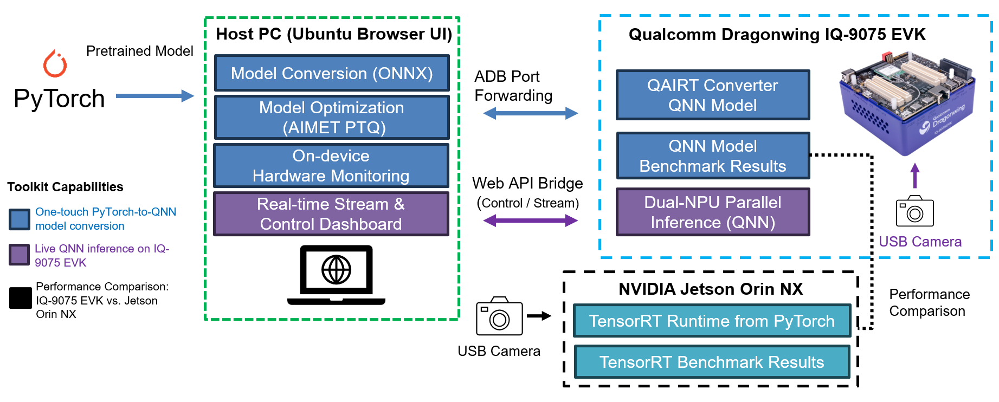
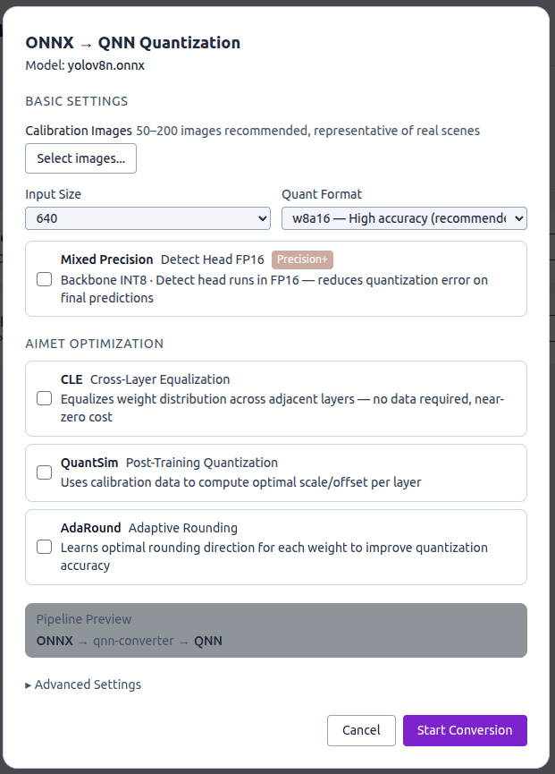
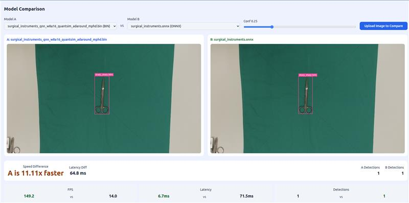

# Qualcomm IQ-9075 Edge AI One-Touch YOLOv11L Model Migration Toolkit

## Advantages of IQ-9075

1. IQ-9075 can provide up to 200 sparse TOPS of AI computing power and supports GPU and DSP accelerated computing
2. The Qualcomm Neural Processing (SNPE) SDK and the Qualcomm AI Engine Direct (QNN) can optimize the performance of trained neural networks
3. It supports Yocto and Ubuntu for AI development

## Performance Metrics

- **AI Model**: YOLOv11L (COCO, 80 classes, 640 × 640) — Object Detection (QNN); YOLOv8n is also supported

| Model | Precision | mAP50 | mAP50-95 | Latency on IQ-9075 (HTP) |
|---|---|---|---|---|
| ONNX (Host PC) | FP32 | 0.779 | 0.617 | — |
| QNN | W8A16 | 0.747 | 0.585 | 25.3 ms |

Evaluated on 100 COCO images. On-device latency is measured with `qnn-net-run` on the HTP backend.

## Hardware

- **Platform**:  [Qualcomm IQ-9075 EVK](https://www.qualcomm.com/developer/hardware/qualcomm-iq-9075-evaluation-kit-evk)
- **Host PC**: Ubuntu x86_64 PC with NVIDIA RTX 30/40 series GPU, connected to the EVK over USB (ADB)

## Software & Toolkit

- **Qualcomm AI Runtime (QAIRT) SDK**：v2.44.0
- **AIMET SDK**：v2.14.0
- **System:** Yocto (Qualcomm Linux 1.5)
- **Host OS:** Ubuntu 20.04 / 22.04

## Background & Solution

### Motivation

- Creating a One-Touch Toolkit to show Qualcomm Edge AI strength on real-time object detection

### Solution

- One-touch PyTorch-to-QNN model conversion for YOLO models (W8A16 / W8A8), with optional AIMET optimization (CLE / QuantSim / AdaRound) and an FP16 detection head
- On-device QNN benchmark on IQ-9075 EVK: latency and mAP
- Live object detection and side-by-side comparison of two models in the browser

## Architecture Diagram

The architecture diagram shows the toolkit workflow, corresponding to the colors in the legend on the left

Blue Phase: Convert the PyTorch model into a QNN model, and evaluate the benchmark for the QNN model

Purple Phase: Perform real-time inference and display the results based on the converted QNN model

## Demo

One-touch ONNX-to-QNN quantization with AIMET optimization options

Model comparison: QNN on the NPU vs. ONNX on the same image

## Contact
If you require any further information, please feel free to contact:

TW: qualcomm.tw@aitgroup.com.tw

CN: qualcomm.cn@aitgroup.com.tw
